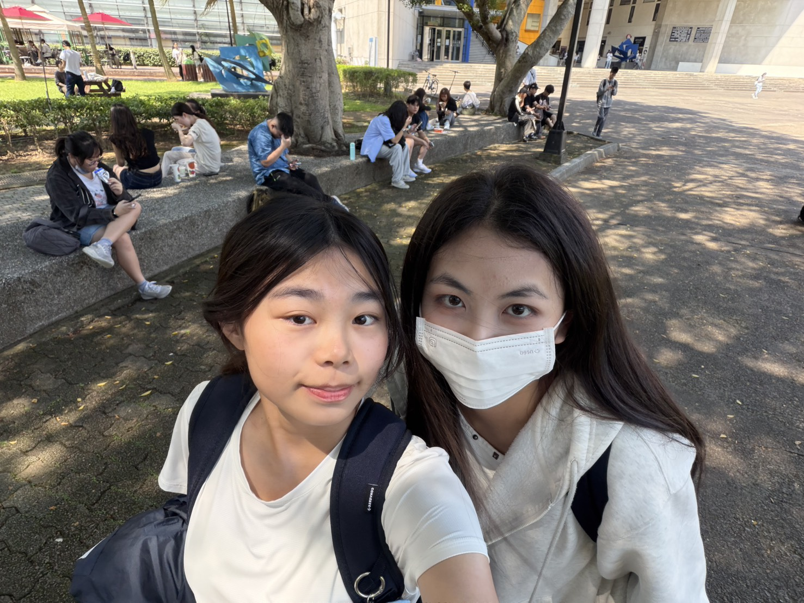
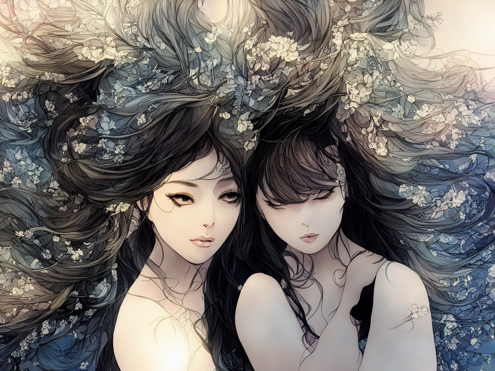
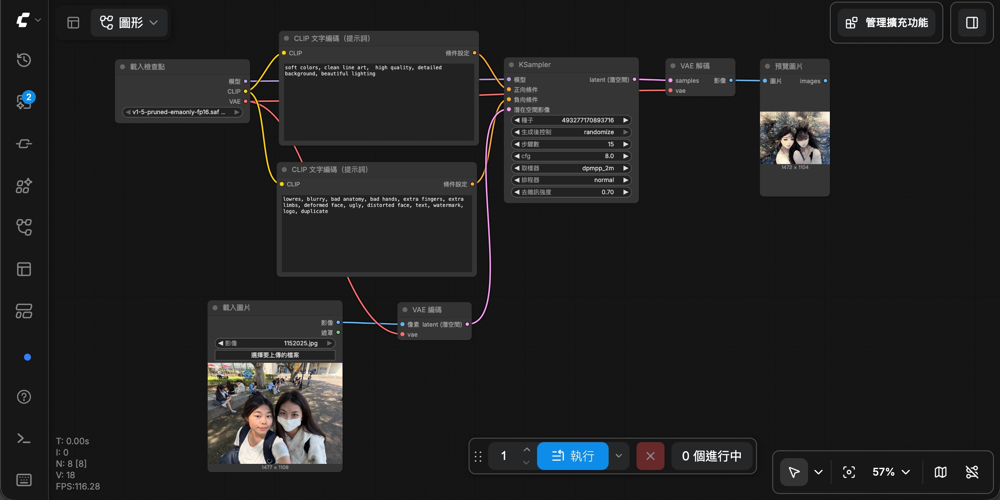

<!DOCTYPE html>
<html lang="en">
<head>
    <meta charset="UTF-8">
    <meta name="viewport" content="width=device-width, initial-scale=1.0">
</head>
<body>
    <h1>原始圖片<h1>
        
    <h1>生成圖片<h1>
        
    <h1>工作流截圖<h1>
        
    <h1>正反提示詞<h1>
        
soft colors, clean line art, high quality, detailed background, beautiful lighting

        
lowres,blurry, bad anatomy, bad hands, extra tingers, extra limbs, deformed face, ugty, distorted face, text, watermark, logo, duplicate

    <h1>個人心得</h1>
    
感覺他跑不出來，然後圖片做出來有點奇怪，可能是提示詞不對，然後工作流感覺有點小複雜，要研究一會才可以，但其實感覺comfy蠻有趣的，之後可能會繼續想嘗試看看。

</body>
</html>